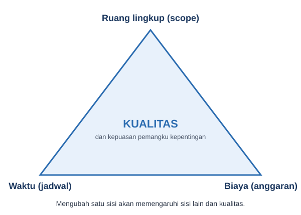

# Pertemuan 1: Pengantar Manajemen Proyek

**Tujuan belajar.** Mahasiswa mampu (a) membedakan proyek dari operasi rutin, (b) menjelaskan batasan tiga serangkai (triple constraint), dan (c) menyebutkan peran serta kompetensi manajer proyek.

## Materi pokok

### 1. Apa itu proyek?
Proyek adalah usaha sementara untuk menghasilkan produk, layanan, atau hasil yang unik. Kata kuncinya ada tiga: *sementara* (punya awal dan akhir), *unik* (tidak persis sama dengan proyek sebelumnya), dan *terarah pada tujuan* (ada hasil yang jelas).

| Proyek | Operasi rutin |
|---|---|
| Membangun gardu induk baru | Mengoperasikan gardu induk setiap hari |
| Merancang dan merakit prototipe sensor | Produksi massal sensor di pabrik |
| Memasang PLTS atap di sebuah sekolah | Pemeliharaan rutin PLTS tersebut |

### 2. Apa itu manajemen proyek?
Penerapan pengetahuan, keterampilan, alat, dan teknik pada aktivitas proyek agar kebutuhan proyek terpenuhi. Intinya: mengubah ide menjadi hasil nyata dengan sumber daya terbatas.

### 3. Triple constraint (segitiga batasan)
Setiap proyek dibatasi oleh tiga hal yang saling memengaruhi: **ruang lingkup** (apa yang dikerjakan), **waktu** (kapan selesai), dan **biaya** (berapa dana tersedia). Kualitas berada di tengah segitiga. Jika satu sisi diubah, sisi lain terpengaruh.

Contoh: klien meminta tambahan 5 kWp panel surya (lingkup naik). Konsekuensinya, biaya naik atau waktu bertambah, atau kualitas dikorbankan. Tugas manajer proyek adalah menyeimbangkan, bukan memaksimalkan salah satunya.

*Gambar 1.1. Triple constraint: ruang lingkup, waktu, dan biaya saling memengaruhi, dengan kualitas di tengahnya.*

### 4. Mengapa proyek gagal?
Penyebab umum: tujuan tidak jelas, estimasi terlalu optimis, perubahan lingkup tanpa kendali, komunikasi buruk, risiko tidak dikelola, dan dukungan pimpinan lemah. Contoh nyata: proyek pembangkit atau jaringan yang molor bertahun-tahun karena pembebasan lahan dan perizinan tidak diperhitungkan sejak awal.

### 5. Peran manajer proyek
Bertanggung jawab atas keberhasilan proyek. Kompetensinya mencakup pengetahuan teknis (cukup untuk memahami keputusan teknis), kepemimpinan, komunikasi, negosiasi, dan pemecahan masalah. Di teknik elektro, manajer proyek sering berlatar belakang insinyur, sehingga transisi dari *mengerjakan* ke *mengatur pekerjaan orang lain* adalah tantangan terbesarnya.

### 6. Ukuran keberhasilan proyek
Selesai tepat waktu, sesuai anggaran, memenuhi spesifikasi, dan diterima pemangku kepentingan.

## Studi kasus singkat
Sebuah kampus ingin memasang PLTS atap 20 kWp. Bedakan: apa yang termasuk proyek (desain, pengadaan, pemasangan, commissioning) dan apa yang termasuk operasi (pembersihan panel bulanan, pembacaan meter). Lalu tentukan batasan triple constraint-nya: lingkup, tenggat sebelum tahun ajaran baru, dan pagu anggaran.

## Aktivitas kelas
- Diskusi 10 menit: sebutkan satu proyek teknik elektro yang pernah dilihat atau dikerjakan, lalu identifikasi tujuan, awal, dan akhirnya.
- Pembentukan kelompok dan pemilihan topik proyek semester.

## Tugas
Tulis satu halaman: pilih sebuah proyek kelistrikan di sekitar Anda (misalnya penambahan penerangan jalan umum), jelaskan ruang lingkup, perkiraan waktu, dan biaya, serta apa yang terjadi bila salah satunya berubah.
