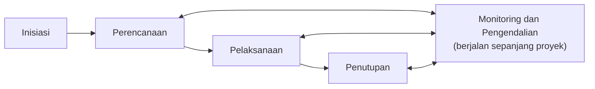

# Pertemuan 2: Siklus Hidup Proyek dan Metodologi

**Tujuan belajar.** Mahasiswa mampu menjelaskan fase siklus hidup proyek, kelompok proses manajemen proyek, dan membandingkan pendekatan waterfall, agile, serta hybrid.

## Materi pokok

### 1. Siklus hidup proyek (project life cycle)
Rangkaian fase dari awal sampai akhir. Contoh generik: Inisiasi, Perencanaan, Pelaksanaan, Penutupan. Pada proyek konstruksi kelistrikan biasanya: studi kelayakan, desain (basic dan detail), pengadaan, konstruksi, pengujian dan commissioning, serah terima.

### 2. Karakteristik siklus hidup
Di awal, biaya dan tenaga kerja masih kecil tetapi ketidakpastian dan pengaruh pemangku kepentingan paling besar. Mendekati puncak pelaksanaan, biaya dan tenaga kerja memuncak. Biaya perubahan makin mahal seiring waktu: mengubah desain di kertas murah, mengubah setelah kabel terpasang mahal.

### 3. Lima kelompok proses (PMBOK)
Initiating, Planning, Executing, Monitoring and Controlling, Closing. Kelompok ini bukan fase yang berurutan kaku, melainkan aktivitas yang berulang di setiap fase.

*Gambar 2.1. Lima kelompok proses PMBOK. Monitoring dan pengendalian menyertai semua fase.*

### 4. Sepuluh area pengetahuan (PMBOK edisi ke-6)
Integrasi, ruang lingkup, jadwal, biaya, kualitas, sumber daya, komunikasi, risiko, pengadaan, pemangku kepentingan. Edisi ke-7 menggeser fokus ke prinsip dan domain kinerja, namun alat-alat dasarnya tetap relevan.

### 5. Pendekatan pengembangan

| Pendekatan | Ciri | Cocok untuk |
|---|---|---|
| Prediktif (waterfall) | Direncanakan penuh di awal, tahap berurutan | Konstruksi, instalasi listrik, proyek dengan spesifikasi tetap |
| Iteratif/inkremental | Hasil dikembangkan bertahap | Pengembangan produk bertahap |
| Agile | Siklus pendek, umpan balik cepat, kebutuhan boleh berubah | Perangkat lunak, firmware, prototipe IoT |
| Hybrid | Gabungan | Produk elektronik: hardware prediktif, firmware agile |

### 6. Standar lain
PRINCE2 (populer di Eropa), ISO 21500/21502 (panduan manajemen proyek), IPMA. Cukup dikenali namanya; fokus kuliah pada kerangka PMBOK.

### 7. Struktur organisasi
Fungsional (manajer proyek berwenang kecil), matriks (berbagi wewenang dengan manajer fungsi), dan proyek (manajer proyek berwenang penuh). Kebanyakan perusahaan rekayasa memakai matriks.

## Contoh
Proyek pembuatan smart energy meter: bagian desain PCB dan casing cocok dengan waterfall (spesifikasi kelistrikan harus pasti), sedangkan firmware dan aplikasi dashboard cocok agile (sering direvisi mengikuti masukan pengguna). Inilah pendekatan hybrid.

## Aktivitas kelas
Kelompok memetakan proyek semester mereka ke dalam fase siklus hidup, menentukan keluaran (deliverable) tiap fase, dan memilih pendekatan yang paling sesuai beserta alasannya.

## Tugas
Buat diagram siklus hidup proyek kelompok dengan keluaran tiap fase (satu halaman).
