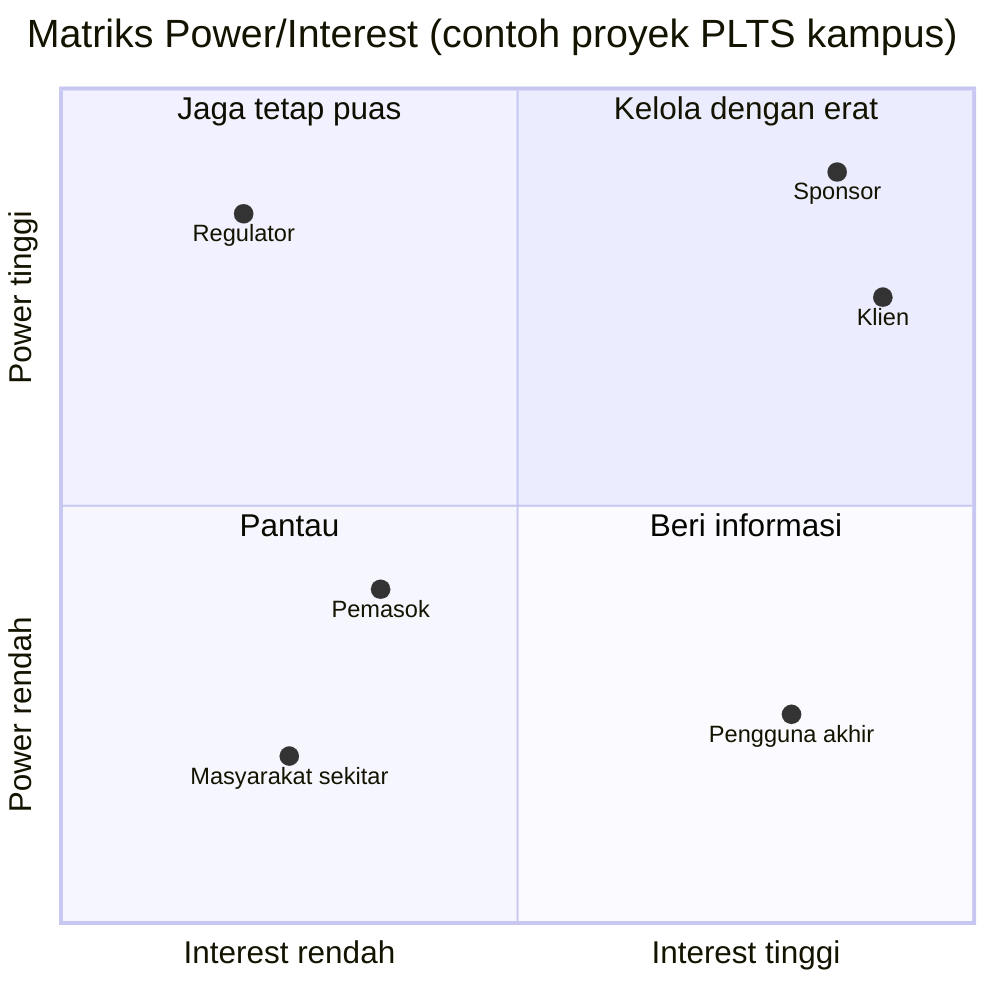

# Pertemuan 3: Inisiasi Proyek dan Manajemen Stakeholder

**Tujuan belajar.** Mahasiswa mampu menyusun project charter, melakukan analisis kelayakan sederhana, dan memetakan stakeholder.

## Materi pokok

### 1. Dari ide menjadi proyek
Proyek berawal dari kebutuhan atau peluang: tagihan listrik terlalu tinggi, mesin sering mati, peraturan baru, atau permintaan pasar. Sebelum dikerjakan, ide perlu dinilai apakah layak.

### 2. Studi kelayakan
Aspek yang diperiksa: teknis (bisakah dibangun dengan teknologi yang ada?), ekonomi/finansial (menguntungkan?), operasional (siapa yang mengoperasikan?), hukum dan perizinan, lingkungan, dan jadwal.

### 3. Analisis finansial dasar
- **Payback period** = investasi awal / penghematan per tahun. Contoh: PLTS atap Rp 100 juta, menghemat Rp 30 juta per tahun, maka payback = 100/30 ≈ 3,3 tahun.
- **NPV (Net Present Value)**: nilai sekarang dari semua arus kas masa depan dikurangi investasi. NPV positif berarti layak. Rumus: NPV = -I0 + Σ Ct/(1+r)^t, dengan r = tingkat diskonto dan t = tahun.
- Aturan sederhana: proyek dengan NPV positif dan payback lebih pendek dari umur manfaat cenderung layak.

### 4. Project charter
Dokumen resmi yang mengesahkan proyek dan memberi wewenang kepada manajer proyek. Isi minimum: judul dan latar belakang, tujuan terukur, ruang lingkup tingkat tinggi, deliverable utama, jadwal dan anggaran garis besar, asumsi dan batasan, risiko awal, stakeholder utama, serta nama manajer proyek dan sponsor.

### 5. Tujuan SMART
Specific, Measurable, Achievable, Relevant, Time-bound.
- Contoh buruk: "Menghemat listrik gedung".
- Contoh baik: "Menurunkan konsumsi listrik gedung A sebesar 15% dalam 6 bulan melalui pemasangan sistem monitoring dan pengaturan beban, dengan biaya maksimal Rp 150 juta".

### 6. Stakeholder
Siapa saja yang memengaruhi atau terpengaruh proyek: sponsor, klien, tim, pemasok, PLN atau regulator, masyarakat sekitar, pengguna akhir. Pemetaan memakai matriks **power/interest**:
- Power tinggi, interest tinggi: *kelola dengan erat* (sponsor, klien)
- Power tinggi, interest rendah: *jaga tetap puas* (regulator)
- Power rendah, interest tinggi: *beri informasi* (pengguna)
- Power rendah, interest rendah: *pantau*

*Gambar 3.1. Pemetaan stakeholder: makin ke kanan atas, makin erat dikelola.*

## Contoh isi charter (ringkas)
Proyek: Sistem Monitoring Energi Gedung Teknik. Tujuan: penurunan konsumsi 15% dalam 6 bulan. Sponsor: Wakil Dekan. Anggaran: Rp 150 juta. Risiko awal: gangguan jaringan data, keterlambatan impor sensor.

## Aktivitas kelas
Kelompok menulis draf project charter dan membuat matriks power/interest dengan minimal 6 stakeholder.

## Tugas
Lengkapi charter dan analisis finansial sederhana (payback dan NPV 5 tahun dengan r = 10%) untuk proyek kelompok.
