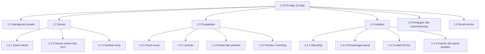

# Pertemuan 4: Manajemen Ruang Lingkup dan WBS

**Tujuan belajar.** Mahasiswa mampu menyusun pernyataan ruang lingkup dan memecah proyek menjadi Work Breakdown Structure (WBS) yang benar.

## Materi pokok

### 1. Mengapa ruang lingkup penting
Penyebab terbesar pembengkakan biaya dan keterlambatan adalah *scope creep*, yakni penambahan pekerjaan sedikit demi sedikit tanpa persetujuan formal. Ruang lingkup yang jelas melindungi tim dan klien.

### 2. Mengumpulkan kebutuhan
Teknik: wawancara, kuesioner, observasi lapangan, workshop, dan studi dokumen (spesifikasi, standar SNI/IEC/PUIL). Setiap kebutuhan harus dapat diuji: bukan "sistem harus cepat", melainkan "waktu respons sensor ke dashboard maksimal 2 detik".

### 3. Pernyataan ruang lingkup (scope statement)
Berisi: deskripsi lingkup, deliverable, kriteria penerimaan, **pengecualian** (apa yang TIDAK termasuk), asumsi, dan batasan. Pengecualian sering terabaikan padahal justru paling melindungi proyek. Contoh: "Instalasi tidak mencakup penambahan daya PLN dan perbaikan atap".

### 4. WBS (Work Breakdown Structure)
Pemecahan hierarkis seluruh lingkup proyek menjadi bagian-bagian yang lebih kecil sampai level *work package* yang bisa diperkirakan, dijadwalkan, dan ditugaskan. WBS berorientasi pada **hasil (kata benda)**, bukan kegiatan.

**Aturan WBS yang baik:**
- **Aturan 100%**: total anak harus mencakup seluruh pekerjaan induknya, tidak kurang dan tidak lebih.
- Tidak ada tumpang tindih antar elemen.
- Level rinci secukupnya: work package umumnya 8-80 jam kerja atau 1-2 minggu.
- Setiap elemen punya kode (1.1, 1.2.1, dst) dan penanggung jawab.

**Contoh WBS PLTS atap 10 kWp:**

```
1 PLTS Atap 10 kWp
├─ 1.1 Manajemen proyek (rencana, laporan, rapat)
├─ 1.2 Desain
│   ├─ 1.2.1 Survei lokasi
│   ├─ 1.2.2 Desain sistem dan single line diagram
│   └─ 1.2.3 Gambar kerja
├─ 1.3 Pengadaan
│   ├─ 1.3.1 Panel surya
│   ├─ 1.3.2 Inverter
│   ├─ 1.3.3 Kabel dan proteksi
│   └─ 1.3.4 Struktur mounting
├─ 1.4 Instalasi
│   ├─ 1.4.1 Mounting
│   ├─ 1.4.2 Pemasangan panel
│   ├─ 1.4.3 Kabel DC/AC
│   └─ 1.4.4 Inverter dan panel proteksi
├─ 1.5 Pengujian dan commissioning
└─ 1.6 Serah terima (dokumentasi, pelatihan operator)
```

Versi diagram (dua level) agar struktur hierarkinya lebih mudah dilihat:



*Gambar 4.1. WBS PLTS atap 10 kWp. Setiap kotak paling bawah adalah work package.*

### 5. Kamus WBS (WBS dictionary)
Tabel penjelas tiap work package: deskripsi, penanggung jawab, kriteria selesai, perkiraan biaya.

### 6. Pengendalian ruang lingkup
Setiap permintaan perubahan diajukan lewat formulir *change request*, dianalisis dampaknya pada waktu, biaya, dan kualitas, lalu disetujui atau ditolak oleh pihak berwenang. Detailnya dibahas di Pertemuan 15.

## Kesalahan umum
WBS berbentuk daftar kegiatan acak, level tidak seimbang, ada pekerjaan yang terlewat (biasanya dokumentasi, pengujian, perizinan), dan tidak ada pengecualian lingkup.

## Aktivitas kelas
Kelompok menyusun WBS tiga level untuk proyek mereka dan saling menilai silang dengan aturan 100%.

## Tugas
Finalkan WBS, kamus WBS untuk 5 work package, dan scope statement termasuk pengecualian.
