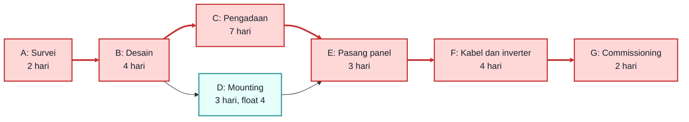

# Pertemuan 5: Manajemen Jadwal I: Aktivitas dan Metode Jalur Kritis (CPM)

**Tujuan belajar.** Mahasiswa mampu menyusun daftar aktivitas, menentukan ketergantungan, menggambar diagram jaringan, dan menghitung jalur kritis serta float.

## Materi pokok

### 1. Dari WBS ke jadwal
Langkah: (1) definisikan aktivitas dari work package, (2) tentukan urutan/ketergantungan, (3) estimasi durasi, (4) buat jaringan kerja, (5) hitung jadwal.

### 2. Jenis ketergantungan
Finish-to-Start (FS, paling umum: B mulai setelah A selesai), Start-to-Start (SS), Finish-to-Finish (FF), Start-to-Finish (SF, jarang). *Lead* adalah percepatan, *lag* adalah penundaan. Contoh lag: beton harus mengering 7 hari sebelum tiang dipasang.

### 3. Estimasi durasi
Berdasarkan pengalaman proyek serupa (analogi), data produktivitas (parametrik), atau pendapat ahli. Hindari menambah cadangan waktu di setiap aktivitas secara diam-diam; lebih baik cadangan dikelola di tingkat proyek.

### 4. Metode Jalur Kritis (CPM)
Jalur kritis adalah jalur terpanjang dalam jaringan, menentukan durasi minimum proyek. Aktivitas di jalur kritis tidak punya kelonggaran: terlambat sehari berarti proyek terlambat sehari.

**Istilah penting:**
- **ES** (Earliest Start), **EF** (Earliest Finish) = ES + durasi. Dihitung dengan *forward pass*.
- **LF** (Latest Finish), **LS** (Latest Start) = LF - durasi. Dihitung dengan *backward pass*.
- **Total float** = LS - ES (atau LF - EF). Float nol berarti kritis.

**Aturan forward pass:** ES aktivitas = nilai EF terbesar dari semua pendahulunya.
**Aturan backward pass:** LF aktivitas = nilai LS terkecil dari semua penerusnya.

## Contoh hitungan lengkap: PLTS atap

| Kode | Aktivitas | Durasi (hari) | Pendahulu |
|---|---|---|---|
| A | Survei lokasi | 2 | - |
| B | Desain sistem | 4 | A |
| C | Pengadaan panel dan inverter | 7 | B |
| D | Pemasangan struktur mounting | 3 | B |
| E | Pemasangan panel | 3 | C, D |
| F | Instalasi kabel dan inverter | 4 | E |
| G | Pengujian dan commissioning | 2 | F |

**Forward pass:**
A: ES 0, EF 2. B: ES 2, EF 6. C: ES 6, EF 13. D: ES 6, EF 9. E: ES = maks(13, 9) = 13, EF 16. F: ES 16, EF 20. G: ES 20, EF 22.

Durasi proyek = **22 hari**.

**Backward pass:**
G: LF 22, LS 20. F: LF 20, LS 16. E: LF 16, LS 13. C: LF 13, LS 6. D: LF = LS dari E = 13, LS = 10. B: LF = min(LS C, LS D) = min(6, 10) = 6, LS 2. A: LF 2, LS 0.

**Float:** D = LS - ES = 10 - 6 = **4 hari**; aktivitas lain 0.

**Jalur kritis: A - B - C - E - F - G (22 hari).**
Aktivitas D punya kelonggaran 4 hari, sehingga tim mounting boleh dimulai terlambat sampai 4 hari tanpa menunda proyek. Pelajaran: fokuskan pengawasan pada pengadaan panel (C), karena keterlambatan pengiriman langsung menunda proyek.

### Diagram jaringan kerja (merah = jalur kritis)

*Gambar 5.1. Jaringan kerja PLTS atap. Jalur kritis A-B-C-E-F-G = 22 hari; aktivitas D punya float 4 hari.*

## Aktivitas kelas
Mahasiswa menghitung ES, EF, LS, LF, dan float untuk contoh baru (dosen memberi 8 aktivitas) secara berpasangan, lalu menggambar diagram jaringan di papan tulis.

## Tugas
Buat daftar aktivitas, ketergantungan, dan durasi untuk proyek kelompok (minimal 15 aktivitas), lalu hitung jalur kritisnya.
