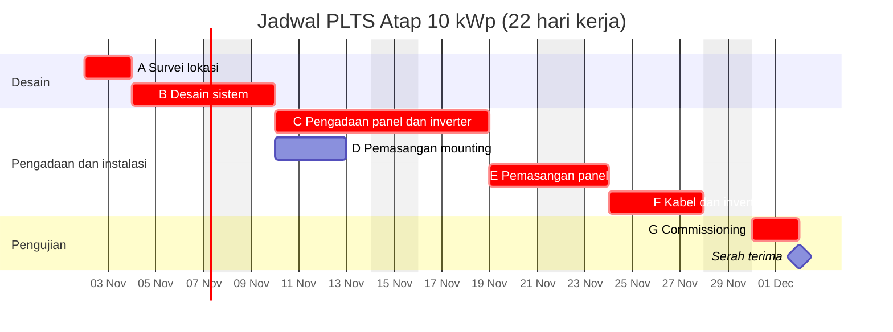

# Pertemuan 6: Manajemen Jadwal II: PERT, Crashing, Gantt Chart, dan Sumber Daya

**Tujuan belajar.** Mahasiswa mampu memakai PERT untuk durasi yang tidak pasti, mempercepat jadwal dengan crashing, membuat Gantt chart, dan meratakan beban sumber daya.

## Materi pokok

### 1. PERT (Program Evaluation and Review Technique)
Dipakai saat durasi tidak pasti, misalnya pekerjaan riset atau pengembangan prototipe. Ada tiga estimasi: **a** (optimistis), **m** (paling mungkin), **b** (pesimistis).

- Durasi harapan: **te = (a + 4m + b) / 6**
- Standar deviasi: **s = (b - a) / 6**, varians = s²

**Contoh:** debugging firmware, a = 2, m = 4, b = 12 hari. te = (2 + 16 + 12)/6 = **5 hari**. s = (12 - 2)/6 = 1,67 hari, varians = 2,78.

Untuk jalur kritis, durasi total = jumlah te, varians total = jumlah varians tiap aktivitas. Peluang selesai tepat waktu dihitung dengan nilai Z = (target - durasi harapan) / standar deviasi total, lalu dibaca dari tabel distribusi normal. Contoh: durasi harapan jalur kritis 40 hari dengan standar deviasi total 3 hari. Target 43 hari memberi Z = 1, sehingga peluang selesai sekitar 84%.

### 2. Mempercepat jadwal
- **Crashing**: menambah sumber daya (lembur, tenaga tambahan) pada aktivitas kritis. Menambah biaya, mengurangi waktu.
- **Fast tracking**: mengerjakan paralel aktivitas yang semestinya berurutan. Tidak menambah biaya langsung tetapi menambah risiko pengerjaan ulang.

**Cara crashing:** pilih aktivitas **kritis** dengan *cost slope* terendah.
*Cost slope* = (biaya crash - biaya normal) / (durasi normal - durasi crash).

Contoh: aktivitas instalasi, normal 6 hari Rp 12 juta, crash 4 hari Rp 18 juta, maka cost slope = (18 - 12)/(6 - 4) = **Rp 3 juta per hari**. Setelah satu aktivitas dipersingkat, periksa apakah jalur kritis berpindah.

### 3. Gantt chart
Diagram batang waktu: sumbu horizontal adalah kalender, tiap baris satu aktivitas, panjang batang adalah durasi. Kelebihan: mudah dibaca klien dan tim. Kelemahan: ketergantungan kurang terlihat; karena itu Gantt dipakai berdampingan dengan diagram jaringan. Tambahkan *milestone* (tonggak, durasi nol) seperti "desain disetujui" dan "energize".

Contoh Gantt chart untuk proyek PLTS atap (durasi dalam hari kerja, hanya untuk ilustrasi; batang merah adalah jalur kritis):

*Gambar 6.1. Gantt chart. Perhatikan aktivitas D (tidak kritis) yang punya ruang untuk digeser.*

### 4. Mengatur sumber daya
*Resource loading*: berapa orang/alat dibutuhkan tiap hari. Bila satu teknisi dijadwalkan dua pekerjaan sekaligus, terjadi *overallocation*. *Resource leveling* menggeser aktivitas non-kritis (memanfaatkan float) agar beban merata, kadang memperpanjang proyek. *Resource smoothing* meratakan beban tanpa mengubah tanggal selesai.

### 5. Cadangan jadwal
Tambahkan *schedule reserve* di akhir jalur kritis, bukan menyebar di tiap aktivitas. Perhatikan faktor lokal: musim hujan, hari libur nasional, waktu pengiriman impor, dan izin pemadaman dari PLN.

## Aktivitas kelas
Praktik membuat Gantt chart dengan Excel atau perangkat lunak seperti MS Project, GanttProject, atau Trello timeline. Latihan crashing dengan data biaya yang diberikan dosen.

## Tugas
Buat Gantt chart lengkap proyek kelompok dengan milestone, tandai jalur kritis, dan jelaskan satu strategi percepatan beserta dampak biayanya.
