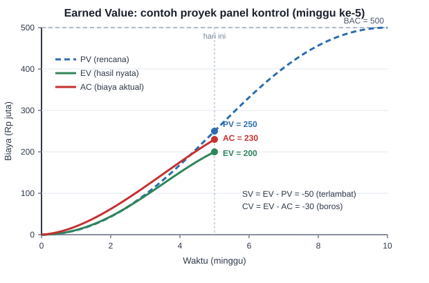

# Pertemuan 7: Manajemen Biaya dan Earned Value Management (EVM)

**Tujuan belajar.** Mahasiswa mampu menyusun estimasi dan anggaran proyek, serta mengukur kinerja biaya dan jadwal dengan Earned Value.

## Materi pokok

### 1. Jenis biaya
*Biaya langsung* (material, tenaga kerja, alat yang melekat pada pekerjaan) dan *biaya tidak langsung* (overhead, supervisi, kantor lapangan). *Biaya tetap* tidak berubah dengan volume, *biaya variabel* berubah mengikuti volume. Jangan lupakan pajak (PPN), asuransi, transportasi, dan biaya perizinan.

### 2. Teknik estimasi
- **Analogi**: memakai biaya proyek serupa sebelumnya. Cepat, akurasi rendah.
- **Parametrik**: biaya per satuan, misalnya biaya PLTS atap per kWp dikali kapasitas. Contoh: Rp 12 juta/kWp x 10 kWp = Rp 120 juta.
- **Bottom-up**: menjumlahkan biaya setiap work package di WBS. Paling akurat dan paling lama.
- **Tiga titik**: memakai rumus PERT untuk biaya, (O + 4M + P)/6.

### 3. Rancangan Anggaran Biaya (RAB)
Di Indonesia, RAB disusun dari volume pekerjaan dikali harga satuan, merujuk Analisis Harga Satuan Pekerjaan (AHSP) dan harga pasar. Tambahkan *contingency reserve* (cadangan untuk risiko yang teridentifikasi, misalnya 5-10%) dan *management reserve* (untuk hal yang tidak terduga).

### 4. Baseline biaya dan kurva-S
Setelah anggaran disetujui dan dijadwalkan per periode, jumlah kumulatifnya membentuk kurva-S. Kurva ini menjadi acuan pembanding untuk kinerja aktual.

### 5. Earned Value Management
Metode terpadu untuk mengukur kinerja biaya dan jadwal sekaligus. Tiga nilai dasar:
- **PV (Planned Value)**: nilai pekerjaan yang *seharusnya* selesai sampai hari ini.
- **EV (Earned Value)**: nilai pekerjaan yang *benar-benar* selesai (persen selesai x anggaran).
- **AC (Actual Cost)**: biaya yang *sudah dikeluarkan*.

**Rumus kinerja:**
- CV (Cost Variance) = EV - AC. Negatif berarti boros.
- SV (Schedule Variance) = EV - PV. Negatif berarti terlambat.
- CPI = EV / AC. Di bawah 1 berarti boros.
- SPI = EV / PV. Di bawah 1 berarti terlambat.
- EAC (perkiraan total biaya saat selesai) = BAC / CPI (bila kinerja saat ini berlanjut).
- ETC = EAC - AC. VAC = BAC - EAC.
- TCPI = (BAC - EV) / (BAC - AC): efisiensi yang dibutuhkan untuk sisa pekerjaan agar anggaran awal tercapai.

## Contoh hitungan lengkap
Proyek panel kontrol, **BAC = Rp 500 juta**, durasi 10 minggu. Di akhir minggu ke-5: seharusnya 50% selesai, aktualnya baru 40%, dan biaya yang sudah keluar Rp 230 juta.

- PV = 50% x 500 = **Rp 250 juta**
- EV = 40% x 500 = **Rp 200 juta**
- AC = **Rp 230 juta**
- CV = 200 - 230 = **-Rp 30 juta** (melebihi anggaran)
- SV = 200 - 250 = **-Rp 50 juta** (terlambat)
- CPI = 200/230 = **0,87**; SPI = 200/250 = **0,80**
- EAC = 500/0,87 ≈ **Rp 575 juta**; ETC = 575 - 230 = **Rp 345 juta**; VAC = 500 - 575 = **-Rp 75 juta**
- TCPI = (500 - 200)/(500 - 230) = 300/270 = **1,11**

**Interpretasi:** proyek terlambat 20% dan boros sekitar 13%. Jika tidak ada perbaikan, total biaya diperkirakan Rp 575 juta. Untuk kembali ke anggaran awal, tim harus bekerja 11% lebih efisien dari rencana, yang berat dan perlu tindakan korektif (tambah tenaga, perbaiki proses, atau negosiasi lingkup).

**Cara cepat mengingat:** angka indeks (CPI, SPI) **di atas 1 itu baik**, di bawah 1 itu masalah. Varians (CV, SV) **positif itu baik**, negatif itu masalah.

*Gambar 7.1. Grafik EVM pada minggu ke-5. EV berada di bawah PV (terlambat) dan di bawah AC (boros).*

## Aktivitas kelas
Latihan EVM dengan tiga skenario berbeda (hemat tapi lambat, boros tapi cepat, boros dan lambat). Mahasiswa menyimpulkan tindakan yang tepat tiap skenario.

## Tugas
Susun RAB bottom-up proyek kelompok (minimal 10 item, lengkap dengan cadangan kontingensi), buat tabel arus kas per bulan dan kurva-S.
