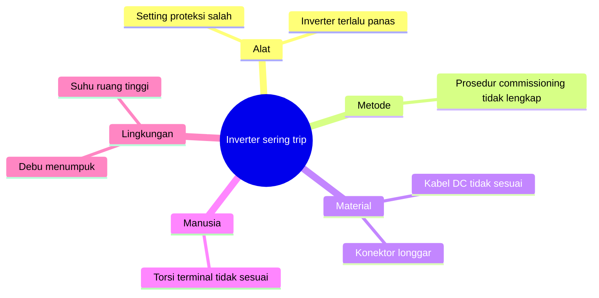
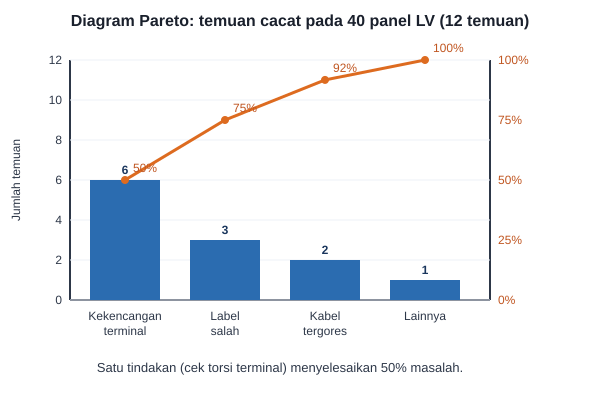

# Pertemuan 9: Manajemen Kualitas

**Tujuan belajar.** Mahasiswa mampu membedakan kualitas dan grade, menyusun rencana kualitas, dan memakai alat pengendali kualitas dasar.

## Materi pokok

### 1. Definisi kualitas
Tingkat kesesuaian hasil dengan kebutuhan dan spesifikasi. *Kualitas* berbeda dengan *grade*: kabel berkualitas baik bisa berkelas rendah (misalnya penampang kecil) asalkan sesuai spesifikasinya. Kualitas rendah adalah masalah; grade rendah belum tentu masalah.

### 2. Tiga proses utama
- **Perencanaan kualitas**: menentukan standar dan cara mencapainya.
- **Jaminan kualitas (QA)**: aktivitas pada *proses* agar hasil sesuai (audit, prosedur kerja, pelatihan). Bersifat mencegah.
- **Pengendalian kualitas (QC)**: memeriksa *hasil* (inspeksi, pengujian). Bersifat mendeteksi.

### 3. Standar yang relevan di teknik elektro
SNI, PUIL 2011 untuk instalasi listrik, IEC dan IEEE untuk peralatan dan metode uji, SPLN untuk lingkungan PLN, ISO 9001 untuk sistem manajemen mutu, serta ISO/IEC 17025 untuk laboratorium uji. Kualitas proyek elektro sangat terkait keselamatan, sehingga standar bukan opsional.

### 4. Biaya kualitas (cost of quality)
*Biaya konformitas*: pencegahan dan penilaian (pelatihan, pengujian). *Biaya non-konformitas*: kegagalan internal (pengerjaan ulang) dan eksternal (klaim garansi, kecelakaan, reputasi rusak). Prinsip: mencegah lebih murah daripada memperbaiki.

### 5. Alat dasar pengendalian kualitas
- **Diagram sebab-akibat (fishbone)**: mencari akar masalah, misalnya inverter sering trip: penyebab dari alat, metode, material, manusia, lingkungan.
- **Diagram Pareto**: 80% masalah biasanya berasal dari 20% penyebab. Fokuskan perbaikan pada penyebab dominan.
- **Check sheet dan histogram**: mengumpulkan dan melihat sebaran data.
- **Control chart**: memantau apakah proses stabil di dalam batas kendali.
- **Siklus PDCA** (Plan-Do-Check-Act): perbaikan berkelanjutan.

Contoh fishbone (diagram sebab-akibat) untuk masalah "inverter sering trip":

*Gambar 9.1. Mencari akar masalah dengan lima kategori penyebab.*

### 6. Pengujian pada proyek elektro
*FAT (Factory Acceptance Test)* dilakukan di pabrik sebelum pengiriman. *SAT (Site Acceptance Test)* dilakukan di lokasi setelah pemasangan. *Commissioning* adalah pengujian fungsional akhir sebelum energize atau serah terima. Contoh pengujian: tahanan isolasi, pentanahan, kontinuitas, uji fungsi proteksi, dan thermal imaging.

### 7. Rencana mutu proyek
Berisi standar yang dipakai, metrik mutu (misalnya jumlah temuan inspeksi per panel), titik inspeksi (*hold point*, *witness point*), dan penanggung jawab.

## Contoh
Pemasangan 40 panel LV menemukan 12 cacat. Hasil Pareto: 6 temuan kekencangan terminal, 3 label salah, 2 kabel tergores, 1 lainnya. Keputusan: tambahkan pemeriksaan torsi terminal wajib dan pelatihan singkat teknisi. Satu tindakan sederhana menyelesaikan 50% masalah.

*Gambar 9.2. Diagram Pareto contoh kasus 40 panel LV. Batang menunjukkan jumlah temuan, garis oranye menunjukkan persentase kumulatif.*

## Aktivitas kelas
Kelompok membuat fishbone untuk masalah "hasil pengukuran sensor tidak akurat" dan menyusun rencana inspeksi proyek mereka.

## Tugas
Buat rencana mutu untuk proyek kelompok: standar yang dipakai, minimal 5 titik inspeksi/pengujian, dan kriteria lulus.
