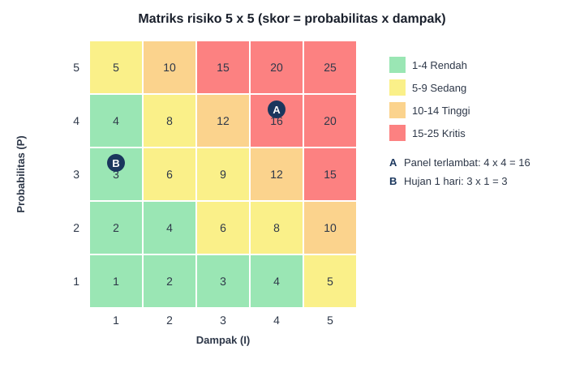

# Pertemuan 10: Manajemen Risiko

**Tujuan belajar.** Mahasiswa mampu mengidentifikasi, menilai, merencanakan respons, dan memantau risiko proyek.

## Materi pokok

### 1. Definisi
Risiko adalah kejadian atau kondisi yang tidak pasti yang, jika terjadi, berdampak pada tujuan proyek. Dapat negatif (ancaman) maupun positif (peluang). *Masalah (issue)* adalah risiko yang sudah terjadi.

### 2. Proses manajemen risiko
Rencanakan, identifikasi, analisis kualitatif, analisis kuantitatif, rencanakan respons, implementasikan respons, pantau.

### 3. Mengidentifikasi risiko
Teknik: brainstorming, wawancara ahli, checklist dari proyek sebelumnya, analisis SWOT, dan analisis asumsi. Kategorikan: teknis, eksternal (cuaca, regulasi, nilai tukar), organisasi, manajemen proyek, dan keselamatan.

**Contoh risiko proyek PLTS atap:** keterlambatan pengiriman panel impor; atap tidak kuat menahan beban; izin pemasangan terlambat; teknisi tersengat listrik saat bekerja; kenaikan kurs dolar; hujan berkepanjangan.

### 4. Analisis kualitatif: matriks probabilitas-dampak
Beri skala 1-5 untuk probabilitas (P) dan dampak (I). **Skor risiko = P x I**.
Contoh: keterlambatan panel, P = 4, I = 4, skor 16 (tinggi). Hujan 1 hari, P = 3, I = 1, skor 3 (rendah). Urutkan risiko berdasarkan skor dan fokus pada yang tertinggi.

*Gambar 10.1. Matriks probabilitas-dampak. Fokuskan respons pada sel merah dan oranye terlebih dahulu.*

### 5. Analisis kuantitatif sederhana: Expected Monetary Value (EMV)
EMV = probabilitas x dampak biaya. Contoh: peluang 30% terjadi kenaikan kurs yang menambah biaya Rp 100 juta, maka EMV = 0,3 x 100 = Rp 30 juta. Jumlah EMV risiko dipakai sebagai dasar cadangan kontingensi.

### 6. Strategi respons

| Ancaman | Peluang | Arti |
|---|---|---|
| Hindari (avoid) | Eksploitasi | Hilangkan penyebab risiko |
| Transfer | Bagi (share) | Pindahkan ke pihak lain (asuransi, kontrak) |
| Mitigasi | Tingkatkan | Kurangi probabilitas atau dampak |
| Terima (accept) | Terima | Aktif (siapkan cadangan) atau pasif |

**Contoh:** risiko keterlambatan panel: *mitigasi* dengan memesan lebih awal dan memakai dua pemasok. Risiko tersengat: *hindari* dengan prosedur lock-out/tag-out dan *mitigasi* dengan APD dan pelatihan. Risiko kerusakan alat saat transport: *transfer* dengan asuransi pengiriman.

### 7. Daftar risiko (risk register)
Tabel hidup berisi: ID, deskripsi, penyebab, probabilitas, dampak, skor, pemilik risiko, respons, dan status. Ditinjau berkala di rapat proyek.

### 8. Risiko sisa dan sekunder
*Risiko sisa* tetap ada setelah respons; *risiko sekunder* muncul akibat respons itu sendiri. Keduanya dicatat.

## Aktivitas kelas
Kelompok membuat risk register dengan minimal 10 risiko, menilai dengan matriks 5x5, dan menentukan respons untuk 3 risiko tertinggi.

## Tugas
Finalkan risk register dan hitung total EMV untuk 3 risiko terbesar.
