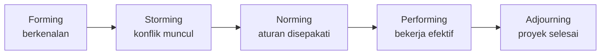

# Pertemuan 11: Manajemen Sumber Daya Manusia dan Komunikasi

**Tujuan belajar.** Mahasiswa mampu membentuk dan memimpin tim proyek, membuat matriks tanggung jawab, serta merencanakan komunikasi.

## Materi pokok

### 1. Perencanaan sumber daya
Tentukan kebutuhan orang, keahlian, alat, dan waktu penggunaannya berdasarkan WBS dan jadwal. Hasilnya: struktur organisasi proyek dan histogram sumber daya.

### 2. Matriks RACI
Menjelaskan peran setiap orang pada tiap pekerjaan: **R**esponsible (mengerjakan), **A**ccountable (penanggung jawab akhir, satu orang saja), **C**onsulted (dimintai pendapat), **I**nformed (diberi tahu).

| Pekerjaan | Manajer proyek | Insinyur desain | Teknisi | Klien |
|---|---|---|---|---|
| Desain single line diagram | A | R | I | C |
| Instalasi panel | A | C | R | I |
| Uji commissioning | A | R | R | C |
| Serah terima | R | I | I | A |

### 3. Tahap perkembangan tim (Tuckman)
Forming (berkenalan), Storming (konflik), Norming (menyepakati aturan), Performing (bekerja efektif), Adjourning (bubar). Tim yang sehat tetap melewati storming; tugas pemimpin adalah membantu melewatinya, bukan menghindarinya.

*Gambar 11.1. Lima tahap perkembangan tim menurut Tuckman.*

### 4. Kepemimpinan dan motivasi
Gaya kepemimpinan menyesuaikan kondisi: mengarahkan (anggota baru), melatih, mendukung, mendelegasikan (anggota berpengalaman). Teori motivasi singkat: Herzberg (faktor higienis dan motivator) dan Maslow. Pengakuan, tantangan yang pas, dan kejelasan peran sering lebih memotivasi daripada sekadar uang.

### 5. Mengelola konflik
Sumber konflik di proyek: jadwal, prioritas, sumber daya, perbedaan teknis, dan kepribadian. Gaya penyelesaian: kolaborasi/pemecahan masalah (terbaik), kompromi, memaksa, menghaluskan, dan menghindar. Pilih berdasarkan situasi, namun utamakan pemecahan masalah.

### 6. Rencana komunikasi
Tentukan siapa butuh informasi apa, kapan, lewat apa, dan dari siapa. Contoh: laporan mingguan ke sponsor (surel), rapat harian 15 menit dengan tim (tatap muka), laporan teknis bulanan ke klien (dokumen).

**Rumus jalur komunikasi:** n(n-1)/2. Tim 5 orang punya 10 jalur, tim 10 orang punya 45 jalur. Makin besar tim, makin rumit komunikasi, sehingga perlu struktur.

### 7. Komunikasi yang efektif
Jelas, ringkas, sesuai audiens. Laporan ke manajemen: status (hijau/kuning/merah), pencapaian, masalah, risiko, dan keputusan yang diminta. Notulen rapat berisi keputusan, penanggung jawab, dan tenggat.

## Aktivitas kelas
Simulasi rapat proyek yang memanas: dua anggota tim berselisih pendapat soal spesifikasi. Mahasiswa memerankan manajer proyek dan mempraktikkan penyelesaian konflik.

## Tugas
Buat matriks RACI dan rencana komunikasi (tabel) untuk proyek kelompok.
