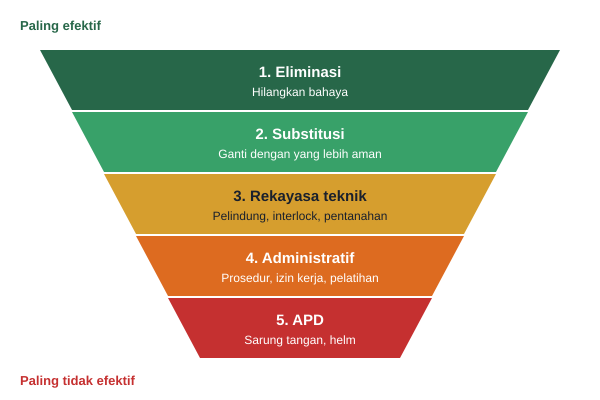

# Pertemuan 13: Keselamatan dan Kesehatan Kerja (K3), Aspek Legal, dan Etika Profesi

**Tujuan belajar.** Mahasiswa mampu menerapkan prinsip K3 pada proyek kelistrikan, mengenali aspek legal utama, dan mengambil keputusan etis sebagai insinyur.

## Materi pokok

### 1. Mengapa K3 sangat penting di teknik elektro
Bahaya listrik tidak terlihat, tidak berbau, dan bisa fatal. Bahaya utamanya: sengatan listrik, arc flash (busur api), kebakaran akibat hubungan pendek, jatuh dari ketinggian (pekerjaan tower, atap), dan bahaya mekanis. Kecelakaan kerja bukan hanya soal kemanusiaan; ia juga menghentikan proyek, menambah biaya, dan menimbulkan sanksi hukum.

### 2. Hierarki pengendalian bahaya (dari paling efektif)
1. *Eliminasi*: hilangkan bahaya (matikan dan kerjakan dalam keadaan tidak bertegangan).
2. *Substitusi*: ganti dengan yang lebih aman (tegangan rendah).
3. *Rekayasa teknik*: pelindung, interlock, pentanahan.
4. *Administratif*: prosedur, izin kerja, rambu, pelatihan.
5. *APD*: sarung tangan isolasi, helm, sepatu safety, pelindung wajah. Ini lapisan terakhir, bukan yang utama.

*Gambar 13.1. Hierarki pengendalian bahaya. Utamakan level atas; APD adalah pertahanan terakhir.*

### 3. Prosedur kerja aman listrik
LOTO (Lock-Out/Tag-Out), pengujian bebas tegangan (*test before touch*), pentanahan sementara, izin kerja (permit to work), analisis keselamatan kerja (JSA/JHA), dan *toolbox meeting* sebelum mulai bekerja.

### 4. Identifikasi bahaya dan penilaian risiko (HIRA)
Gunakan matriks risiko seperti pada Pertemuan 10, tetapi fokus pada keselamatan. Contoh: pekerjaan di panel hidup, bahayanya sengatan dan arc flash, pengendalian: matikan dan LOTO, APD tingkat sesuai, hanya petugas kompeten.

### 5. Kerangka hukum di Indonesia (pengenalan)
Mahasiswa perlu mengetahui keberadaan: undang-undang keselamatan kerja, undang-undang ketenagalistrikan, PUIL, regulasi sistem manajemen K3 (SMK3), serta sertifikasi seperti SLO (Sertifikat Laik Operasi) untuk instalasi listrik dan sertifikat kompetensi tenaga teknik ketenagalistrikan. Karena peraturan sering diperbarui, selalu verifikasi versi terbaru sebelum dipakai di proyek nyata. Standar internasional pendukung: ISO 45001 (sistem manajemen K3) dan NFPA 70E (keselamatan listrik).

### 6. Aspek legal lain
Perizinan (IMB/PBG, izin lingkungan, izin operasi), hak kekayaan intelektual (desain, firmware, lisensi perangkat lunak), kerahasiaan (NDA), dan perlindungan data bila proyek menyentuh sistem IoT.

### 7. Etika profesi insinyur
Prinsip umum kode etik insinyur (misalnya Persatuan Insinyur Indonesia dan IEEE): mengutamakan keselamatan, kesehatan, dan kesejahteraan publik; bekerja dalam batas kompetensi; jujur dalam laporan dan data; menghindari konflik kepentingan; menolak suap dan gratifikasi; dan menghargai kekayaan intelektual.

## Kasus diskusi
Anda manajer proyek dan jadwal sudah terlambat dua minggu. Klien menekan agar pengujian pentanahan dilewati supaya listrik bisa dinyalakan. Apa yang Anda lakukan? Gunakan langkah: (1) kenali fakta, (2) siapa terdampak, (3) peraturan dan standar yang relevan, (4) alternatif tindakan, (5) keputusan dan alasannya.

Jawaban etis: keselamatan tidak boleh dikompromikan; cari solusi lain seperti menambah tim uji atau menegosiasi ulang jadwal dan mendokumentasikan keputusan secara tertulis.

## Aktivitas kelas
Kelompok menyusun JSA untuk satu pekerjaan berisiko pada proyek mereka (misalnya pemasangan panel surya di atap) dengan kolom: langkah kerja, bahaya, pengendalian, penanggung jawab.

## Tugas
Buat rencana K3 proyek kelompok: daftar bahaya utama, pengendalian, APD, dan prosedur darurat.
