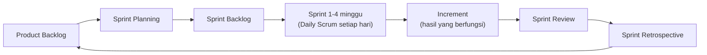

# Pertemuan 14: Agile dan Proyek Produk Elektronik/Embedded

**Tujuan belajar.** Mahasiswa mampu menjelaskan prinsip agile dan Scrum, serta memilih pendekatan yang tepat untuk proyek pengembangan produk berbasis hardware dan firmware.

## Materi pokok

### 1. Mengapa agile
Pada pengembangan produk, kebutuhan sering berubah dan belum jelas di awal. Pendekatan waterfall yang menetapkan semua di awal berisiko menghasilkan produk yang tidak diinginkan pengguna. Agile mengatasi ini dengan siklus pendek dan umpan balik cepat.

### 2. Nilai Agile Manifesto
Individu dan interaksi di atas proses dan alat; perangkat lunak/produk yang berfungsi di atas dokumentasi lengkap; kolaborasi dengan pelanggan di atas negosiasi kontrak; menanggapi perubahan di atas mengikuti rencana. Bukan berarti dokumentasi dan rencana dibuang, hanya prioritasnya berbeda.

### 3. Scrum
- **Peran**: *Product Owner* (menentukan prioritas dan nilai produk), *Scrum Master* (memfasilitasi proses), *Developers/Tim* (membuat produk).
- **Artefak**: *Product Backlog* (daftar kebutuhan berprioritas), *Sprint Backlog* (item yang dikerjakan pada sprint ini), *Increment* (hasil yang bisa dipakai).
- **Acara**: *Sprint* (1-4 minggu), *Sprint Planning*, *Daily Scrum* (15 menit), *Sprint Review* (demo ke pemangku kepentingan), *Sprint Retrospective* (evaluasi proses).
- **User story**: "Sebagai teknisi, saya ingin melihat konsumsi daya per ruangan di dasbor agar bisa menemukan pemborosan". Kriteria penerimaan ditulis jelas.

*Gambar 14.1. Siklus Scrum. Hasil review dan retrospektif memperbarui product backlog untuk sprint berikutnya.*

### 4. Kanban
Papan visual dengan kolom To Do, In Progress, Review, Done, dan batas pekerjaan yang sedang dikerjakan (WIP limit). Cocok untuk pekerjaan pemeliharaan atau aliran tugas yang terus datang.

### 5. Tantangan agile untuk hardware
Hardware tidak bisa diubah secepat kode: pembuatan PCB butuh minggu, komponen punya lead time, dan perubahan desain mahal. Praktik adaptasi:
- Pecah menjadi *modul* dan uji lebih dulu pada papan pengembangan (Arduino, ESP32, STM32) sebelum PCB final.
- Gunakan prototipe bertahap: proof of concept, EVT (Engineering Validation Test), DVT (Design Validation Test), PVT (Production Validation Test).
- Bekukan desain hardware lebih awal (pendekatan prediktif) sambil firmware dan aplikasi mengalir secara agile (hybrid).
- Simulasi dan *hardware-in-the-loop* untuk mengurangi siklus fisik.

### 6. Contoh proyek IoT monitoring energi
- Sprint 1: sensor arus dan tegangan terbaca di mikrokontroler (rilis internal).
- Sprint 2: data terkirim ke server lewat MQTT.
- Sprint 3: dasbor sederhana menampilkan kWh per ruangan.
- Sprint 4: notifikasi pemborosan dan kalibrasi akurasi.
- Setiap sprint ditutup dengan demo ke pengguna (staf gedung), dan masukannya mengubah backlog.

### 7. Metrik agile
*Velocity* (jumlah poin cerita yang selesai per sprint), *burndown chart* (sisa pekerjaan terhadap waktu), dan *lead time*. Jangan memakai metrik untuk membandingkan atau menghukum tim; gunakan untuk memprediksi dan memperbaiki.

### 8. Memilih pendekatan
Pertanyaan penuntun: seberapa pasti kebutuhannya? seberapa mahal perubahan? apakah ada regulasi ketat? Bila kebutuhan pasti dan perubahan mahal, pilih prediktif. Bila kebutuhan berkembang dan perubahan murah, pilih agile. Bila campuran, pilih hybrid.

## Aktivitas kelas
Simulasi satu sprint mini (45 menit): kelompok membuat product backlog 8 item untuk produk fiktif (misalnya smart plug), memilih 3 item untuk sprint, lalu menggambar papan Kanban dan burndown chart sederhana.

## Tugas
Tentukan apakah proyek kelompok lebih cocok prediktif, agile, atau hybrid, lalu tuliskan alasannya dan buat backlog awal.
