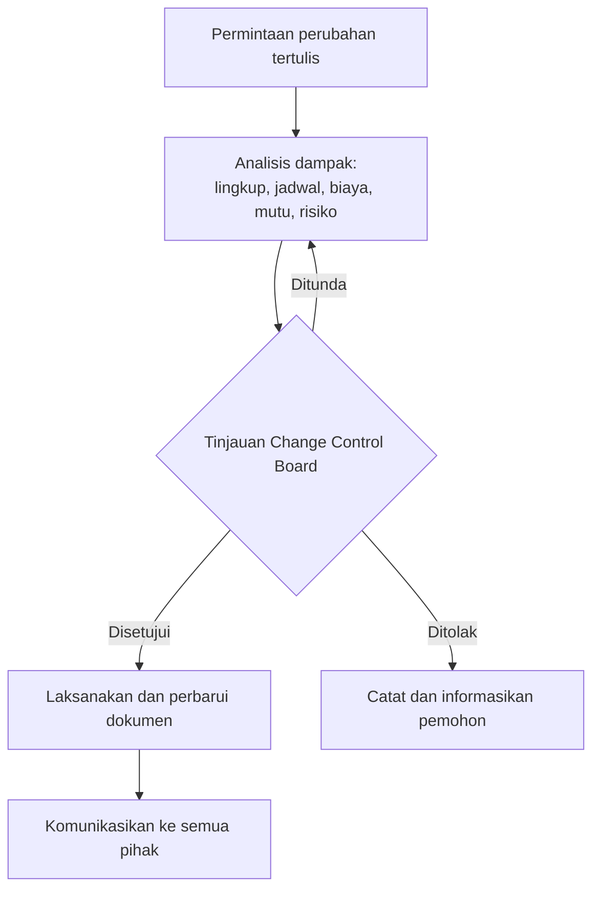

# Pertemuan 15: Monitoring, Pengendalian Perubahan, Penutupan, dan Tools Manajemen Proyek

**Tujuan belajar.** Mahasiswa mampu memantau dan mengendalikan proyek, mengelola perubahan secara formal, menutup proyek dengan baik, dan memakai perangkat lunak pendukung.

## Materi pokok

### 1. Memantau dan mengendalikan
Membandingkan rencana dengan kenyataan secara rutin, lalu mengambil tindakan. Siklusnya: ukur, bandingkan, analisis penyimpangan, putuskan tindakan, laksanakan, ukur lagi. Alat: EVM (Pertemuan 7), kurva-S, laporan kemajuan mingguan, rapat progres, inspeksi lapangan, dan risk register.

### 2. Laporan status proyek
Singkat dan faktual: ringkasan status (indikator hijau/kuning/merah untuk jadwal, biaya, mutu, risiko), kemajuan fisik terhadap rencana, masalah utama, risiko baru, tindakan korektif, dan hal yang perlu keputusan. Gunakan data, bukan perasaan.

### 3. Tindakan pengendalian
*Tindakan korektif* (mengembalikan kinerja ke rencana), *tindakan pencegahan* (mengurangi kemungkinan penyimpangan di masa depan), dan *perbaikan cacat* (memperbaiki hasil yang tidak sesuai).

### 4. Pengendalian perubahan terpadu
Perubahan pasti terjadi. Yang harus dihindari adalah perubahan tanpa kendali. Alur:
1. Permintaan perubahan diajukan tertulis.
2. Dianalisis dampaknya pada lingkup, jadwal, biaya, mutu, risiko.
3. Ditinjau oleh *Change Control Board* (atau sponsor/klien).
4. Disetujui, ditolak, atau ditunda.
5. Dilaksanakan dan dokumen diperbarui.
6. Dikomunikasikan.

Di kontrak konstruksi, perubahan lingkup biasanya berbentuk *variation order*.

*Gambar 15.1. Alur pengendalian perubahan terpadu.*

### 5. Manajemen konfigurasi
Pada proyek teknik, pastikan dokumen dan versi desain terkendali: gambar *as-built*, revisi firmware, daftar komponen (BOM). Kekacauan versi sering menyebabkan kesalahan produksi dan instalasi.

### 6. Penutupan proyek
1. Verifikasi semua deliverable dan kriteria penerimaan terpenuhi.
2. Pengujian akhir dan serah terima (berita acara serah terima, BAST).
3. Dokumentasi akhir (gambar as-built, manual, sertifikat uji, garansi).
4. Pelatihan operator.
5. Pembayaran akhir dan penutupan kontrak, pelepasan jaminan.
6. Pelepasan sumber daya tim.
7. Arsip dokumen.

### 7. Pelajaran yang dipetik (lessons learned)
Dikumpulkan dalam rapat evaluasi: apa yang berjalan baik, apa yang salah, dan apa yang diubah di proyek berikutnya. Catat secara tertulis agar organisasi belajar, bukan hanya individu.

### 8. Perangkat lunak pendukung

| Kebutuhan | Contoh tools |
|---|---|
| Penjadwalan klasik (CPM, Gantt, sumber daya) | MS Project, Primavera P6, GanttProject (gratis) |
| Tugas tim dan Kanban | Trello, Jira, Asana, Notion |
| Anggaran dan EVM | Microsoft Excel, Google Sheets |
| Dokumen dan komunikasi | Google Workspace, Microsoft Teams, Slack |
| Desain dan versi | Git (firmware), CAD seperti AutoCAD Electrical, EPLAN |

Tools hanya membantu. Perencanaan yang buruk tetap buruk meskipun dibuat dengan aplikasi yang canggih.

## Aktivitas kelas
Studi kasus: laporan status minggu ke-8 sebuah proyek fiktif yang melaporkan CPI 0,85, SPI 0,9, dan dua permintaan perubahan dari klien. Kelompok menyusun tanggapan: tindakan korektif, analisis dampak, dan keputusan atas perubahan.

## Tugas
Lengkapi dokumen rencana proyek kelompok dengan: rencana pemantauan (indikator dan frekuensi), prosedur perubahan (formulir), dan rencana penutupan. Siapkan presentasi untuk Pertemuan 16.
